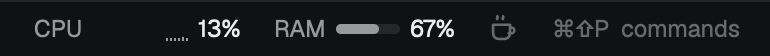

# Herdr Workspace Status

The status bar at the bottom of the Herdr desktop window, extended: the stock machine, branch, agent count, and palette hint, plus a local CPU sparkline, a physical-RAM meter, and a keep-awake cup. It works on macOS and Windows.

## What you see

One strip across the bottom of the window, 28px tall, on `theme.chrome` with a 1px top border in `theme.border`, 14px side padding, 16px between groups, 11.8px type in `theme.muted`. Left to right:

- **Machine.** A 13px icon from Herdr's own `mods/workspace-chrome/` — `monitor` for the local machine, `server` for a remote space — then the space's machine name, or `This computer` locally.
- **Branch.** Only when the active space has one: a 13px `branch` icon and the branch name.
- **Agents.** A 6px dot in `theme.dim`, then `N agents`. When at least one agent is blocked, `· N needs you` follows in `theme.blocked`.
- A flexible gap, then the right-hand cluster, 8px apart:
  - `Local`, only in a remote space.
  - `CPU`, a 47×12 sparkline of up to 24 one-pixel bars growing from the right, then the percentage in a fixed 30px column in `theme.foreground`.
  - `RAM`, a 32×5 rounded track with a proportional fill, then the percentage.
  - The cup: 17px `coffee.svg`, `theme.dim` when off and `theme.accent` when awake.
  - The palette hint: the key actually bound to `app.palette` (`⌘⇧P  commands` on macOS, `Ctrl+Shift+P  commands` on Windows), or just `commands` when nothing is bound.

An unavailable reading shows `—` with an empty sparkline; it is never reported as 0%.

## How it behaves

- **Sampling.** Every five seconds after the previous sample returns. macOS runs two commands (`iostat` for one second, `vm_stat` + `sysctl`), so the bar refreshes about every six seconds; Windows runs one PowerShell child, observed at 6.7–6.9 seconds between sampler starts. The sparkline keeps the last 24 CPU readings; RAM has no history.
- **Cup states.** Off, `manual`, and `agents`, with the tooltip naming the state. Left-click from off starts `manual`, which ignores agents; left-click again turns it off. Right-click starts `agents` when at least one agent is working — replacing `manual` if it was on — and turns `agents` off on the next right-click. With no working agent, right-click changes nothing and posts an info notification: *Keep awake — No working agents to follow.* From `agents`, a left-click turns it off; the next left-click starts `manual`.
- **Working-agent mode.** While it is on, every renewal step re-checks the agents. Once none is working, the mode stops: within one renewal step (2.8s) plus the lease already issued (4s on macOS, a 3.8s deadline on Windows).
- **Renewal.** Every 2.8s one native lease is started: `/usr/bin/caffeinate -di -t 4` on macOS; on Windows one PowerShell child that sets Display and System power requests and holds them until an absolute 3.8s deadline, then exits. Leases are not awaited, so a slow child never shortens coverage. Nothing in the mod releases a lease — the OS does, when the process ends — so switching layout, removing the mod, or killing Herdr is bounded by one lease.
- **Palette.** `herdr-workspace-status.awake-left` and `herdr-workspace-status.awake-right` do exactly what the two clicks do, and appear as **Toggle keep awake manually** and **Keep awake while agents work**.
- **Hover and motion.** Hovering the cup shows its tooltip. Nothing animates; there are no overlays, dialogs, or keys of its own.

## Built from

- `mod.json` — version `1.0.1` for this mod; `place: "none"` (the mod appears only where a layout names it), the two commands above, and `cloned_from` naming Herdr's `workspace-status` 0.1.16. `windows/mod.json` carries the same mod version and commands without `cloned_from`; on Windows it replaces the manifest. `cloned_from.version` is the source mod's version, not this mod's version.
- `main.js` — one `View` class. It reads `spaces()`, `agents()`, `theme()`, `window()`, `keys()` and `checking()`; calls `exec`, `nextCommand`, `notify` and `run("app.palette")`; owns the bar layout, the sparkline, the meter, the cup, and the palette hint.
- `sample.js` — `cpuPercent` (100 minus the idle field of the last `iostat` row), `ramPercent` (active + wired + compressor + speculative pages times page size over `hw.memsize`), `windowsMetrics` (validated `cpu`/`ram` from the PowerShell JSON), and `selfCheck`, which runs when `checking()` is true.
- `awake.js` — `AwakeControl` (the off/manual/agents machine with a generation counter that cancels an in-flight renewal), `RENEW_MS = 2800`, `NATIVE_LEASE_MS = 3800`, and the Windows lease: a C# class compiled with `Add-Type` that calls `PowerCreateRequest`, `PowerSetRequest` and `PowerClearRequest` for request types 0 and 1, shipped as UTF-16LE base64 through `-EncodedCommand` so no quoting reaches the PowerShell parser.
- `coffee.svg` — the cup, 292 bytes, drawn in `currentColor`.
- **Programs.** `/usr/sbin/iostat`, `/usr/bin/vm_stat`, `/usr/bin/sysctl`, `/usr/bin/caffeinate` on macOS; `powershell.exe` on Windows.
- **Layout.** The bar is the block `{"id": "status", "type": "block", "content": {"mod": "herdr-workspace-status"}, "size": {"px": 28}}`, which replaces Herdr's `workspace-status` block in a cloned layout.

## Watch out

- `window()` is null during early init. Resolve the platform on every pass, not once in `init`, or the first sampler pass is lost.
- The cup and the lease must use the same platform predicate (`macos` or `windows`). A cup drawn where no lease exists looks broken; a lease with no cup cannot be turned off.
- Commands only fire when the manifest declares them, so the Windows manifest is required, not optional. Windows installs must also copy `coffee.svg`: the icon path is `mods/herdr-workspace-status/coffee.svg` on both platforms.
- Never `await` a lease in the renewal loop. Each step starts the next lease immediately; awaiting the child would leave gaps of a full sample interval.
- The `exec` timeout must exceed the lease (6s against a 4s `caffeinate`; 3.8s + 3.2s against the Windows deadline), or a slow start reports a failure that is not one.
- `iostat -c 2` prints a since-boot row first. Parse the last row, and return null on anything malformed rather than a plausible-looking 0.
- macOS RAM counts active, wired, compressed, and speculative pages, so it reads higher than Activity Monitor's "Memory Used". Do not "fix" it to match.
- Check mode has no running event loop: gate every `cx.spawn` behind `!checking()`, or `herdr-app check` hangs.
- The sparkline is capped at 24 bars in 47px, so a narrow window squeezes the palette hint before the meters.

## Done when

- `herdr-app check <mod dir>` passes: the parsers' self-check runs, and the first render builds.
- `bun test` passes, covering the mode machine, the working-agent transition, and the Windows lease command and deadline.
- On macOS, the bar shows CPU and RAM values that change, `pmset -g assertions` lists a `caffeinate` display assertion while `manual` is on and none within about four seconds of turning it off, and the sparkline fills from the right.
- On Windows, `powercfg /requests` lists DISPLAY and SYSTEM while the cup is awake and neither after it is turned off.
- Right-click with no working agent leaves the mode unchanged and shows the info notification; `herdr-workspace-status.awake-left` and `awake-right` reproduce both clicks.
